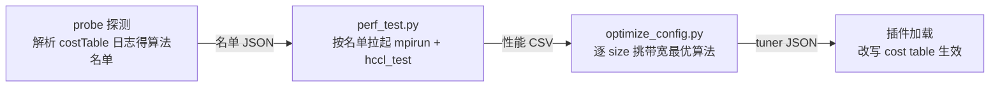

# HCCL Tuner Plugin 示例

## 概述

本目录提供 HCCL Tuner Plugin 的参考实现，演示如何通过外部 `.so` 插件读取 JSON 配置并修改cost table，影响 Selector 的算法选择。

> **孵化中（Incubating）特性**：实验性能力，默认未开放（需设置 `HCCL_TUNER_PLUGIN` 启用）；转稳定前不保证接口兼容。

## 编译

```bash
source /usr/local/Ascend/cann/set_env.sh
make
```

产物：`hccl_tuner_example.so`

首次构建会自动下载 nlohmann/json（header-only）到 `third_party/`。离线场景可手动预放 `third_party/nlohmann/json.hpp`，make 检测到即跳过下载。

## 使用

```bash
export HCCL_TUNER_PLUGIN=/path/to/hccl_tuner_example.so
export HCCL_TUNER_CONFIG_FILE=/path/to/hccl_tuner_config.json
```

插件按以下顺序查找配置文件，找到第一个可读的即加载：

1. `$HCCL_TUNER_CONFIG_FILE`（未设置时跳过）
2. `./hccl_tuner_config.json`
3. `/etc/hccl/hccl_tuner_config.json`

## 数据采集与配置生成

手工编写 JSON 配置难以猜中各拓扑下的最优算法。本目录提供两个脚本，把这件事变成三步：



### 第一步：探测算法名单 + 采集性能数据（perf_test.py）

脚本先自动探测（probe，内嵌在采集流程里，无感知）：先按引擎分轮试跑 hccl_test，从日志的
costTable 找出当前环境真正支持的算法，存成名单 JSON；然后只测名单里的算法（再按
命令行参数过滤），把各数据量下的带宽和时延写入 CSV。
名单来自实际试跑，保证测到的就是真实可用的算法，避免"配了 A、实际跑的是 B
（静默回退）"导致耗时数据张冠李戴。

运行前请确认：

- Python >= 3.8
- `mpirun` 在 PATH 中（MPICH 或 Open MPI 均可）。版本要求见[官方安装文档](https://gitcode.com/cann/oam-tools/blob/master/docs/zh/hccl_test/inst_and_compile.md)：
  Open MPI 统一 4.1.5（IPv6 仅此版本支持）；MPICH 按产品：950/A3 系 4.1.3，A2/Atlas 系 3.2.1
- 已 source CANN 环境变量（`$ASCEND_HOME_PATH` 已设置），hccl_test 位于
  `$ASCEND_HOME_PATH/tools/hccl_test/bin/`（可用 `--bin-dir` 改）；
  hccl_test 链接的 MPI 运行库（如 libmpi.so.12）也需在 `LD_LIBRARY_PATH` 中
- 设备前提：仅 950/960 系（探测依赖 costTable 日志），910B 暂不支持
- 脚本要在 mpirun 会话外运行，检测到嵌套 MPI 会话会直接报错退出
- 多机 + MPICH：hostfile 语法见 `--hostfile` 参数；首节点 source CANN 环境即可，依赖库同路径部署
- 多机 + Open MPI：hostfile 须用 Open MPI 语法（见 `--hostfile` 参数）；`--prefix`、环境透传等
  参数由脚本自动补齐，同样只需首节点 source，依赖库同路径部署

命令示例：

```bash
# 环境变量（参考 hccl_test 官方执行文档 https://gitcode.com/cann/oam-tools/blob/master/docs/zh/hccl_test/execution.md）
ulimit -n 65535
export INSTALL_DIR=/usr/local/Ascend/cann
source $INSTALL_DIR/set_env.sh
# MPICH
export PATH=/usr/local/mpich/bin:$PATH
export LD_LIBRARY_PATH=/usr/local/mpich/lib:${INSTALL_DIR}/lib64:$LD_LIBRARY_PATH
# or Open MPI
export PATH=/usr/local/openmpi/bin:$PATH
export LD_LIBRARY_PATH=/usr/local/openmpi/lib:${INSTALL_DIR}/lib64:$LD_LIBRARY_PATH

python3 perf_test.py --op-types allreduce,allgather --engines aicpu,ccusched --np-total 16 --npus 8 \
    --hostfile hostfile --minbytes 1K --maxbytes 2G --stepfactor 2 \
    --data-types fp32 --reduce-ops sum,prod --output hccl_perf.csv
```

#### 参数说明

| 参数 | 必填 | 默认值 | 说明 |
|------|------|--------|------|
| `--op-types` | 是 | — | 采集的算子，逗号分隔，支持 `all`；支持值见下方[支持的 op_type](#支持的-op_type) |
| `--np-total` | 是 | — | 总 rank 数，即 `mpirun -n` 的值 |
| `--npus` | 否 | 自动推导 | 每台服务器的 NPU 数，透传给 hccl_test `-p`。缺省自动推导：`np-total ÷ 服务器行数`（hostfile 非注释行数），如 `--np-total 16` + 2 行 hostfile → 每机 8；单机即 `np-total`；除不尽时启动报错，需显式指定 |
| `--hostfile` | 否 | 不传则单机（servers=1） | 多机 hostfile 文件，单机不用传。MPICH 语法：每行写一条 `IP:每机NPU数`（如 `10.10.130.22:8`）或纯 `IP`，`#` 开头的注释行和空行忽略；两种格式不可混用。Open MPI 语法：每行 `IP slots=每机NPU数`（如 `10.10.130.22 slots=8`） |
| `--minbytes` / `--maxbytes` | 否 | 不传则不限定区间 | 数据量区间，对应 `-b` / `-e`；两者必须同时给。单位：纯数字按字节，`K`/`M`/`G` 后缀按 1024 进制（1K=1024B，1M=1024K），支持小数（如 `1.5K`） |
| `--stepbytes` | 否 | 不传则 hccl_test 默认序列 | 线性步进（字节），正整数，对应 `-i`，与 `--stepfactor` 互斥；两者都不传时由 hccl_test 按默认序列扫点 |
| `--stepfactor` | 否 | 不传则 hccl_test 默认序列 | 等比步进因子，对应 `-f`，浮点（典型值 2，即 1K→2K→4K…）；与 `--stepbytes` 互斥 |
| `--data-types` | 否 | `fp32` | 数据类型，逗号分隔，支持 `int8`/`uint8`/`int16`/`uint16`/`int32`/`uint32`/`int64`/`uint64`/`fp16`/`fp32`/`fp64`/`bfp16`/`fp8e5m2`/`fp8e4m3`/`fp8e8m0`/`hif8`，对应 `-d` |
| `--reduce-ops` | 否 | `sum` | reduce 类算子的操作类型，逗号分隔，支持 `sum`/`prod`/`max`/`min`，对应 `-o`；probe 按该维度展开，非 reduce 类算子不受影响 |
| `--engines` | 否 | `all` | 采集引擎，支持 `aicpu` / `aiv` / `dpu` / `ccums` / `ccusched`，`all` 展开全部（见下方说明） |
| `--algos` | 否 | 全量 | 显式指定算法串（`HCCL_ALGO` 语义，如 `sole{mesh};parallel{mesh,nhr}`），与 probe 名单求交集 |
| `--executors` / `--templates` | 否 | 全量 | 按执行器 × 模板展开组合，再与 probe 名单求交集（`--algos` 存在时忽略）；支持值见下方 executor/template 可选值。与 JSON 配置的同名字段口径不同：此处枚举校验，JSON 侧不校验 |
| `--warmup-iters` | 否 | 10 | 预热次数，对应 `-w` |
| `--iters` | 否 | 20 | 迭代次数，对应 `-n` |
| `--run-timeout` | 否 | 600 | 单轮超时秒数，超时杀掉整轮进程，按失败继续 |
| `--pods` | 否 | 0 | Pod 数；0 表示未指定，生成的配置不约束该维度 |
| `--super-pods` | 否 | 0 | 超节点数；同上 |
| `--output` | 否 | `hccl_perf.csv` | CSV 输出路径 |
| `--probe-output` | 否 | `<output>.algos.json` | probe 算法名单 JSON 路径；已有名单且拓扑/参数匹配时自动复用，删除该文件可强制重探 |
| `--bin-dir` | 否 | `tools/hccl_test/bin` | hccl_test 目录，相对 `$ASCEND_HOME_PATH` 或绝对路径 |

白名单类参数（`--op-types` / `--data-types` / `--reduce-ops` / `--engines` / `--executors` / `--templates`）出现白名单外的值时，启动时直接报错并列出合法集合。

#### 采集行为说明

- **引擎映射**：`--engines` 引擎名与 hccl_test 的 `-a` 开关由脚本自动映射（`aicpu → -a aicpu_ts`，`aiv → -a aiv_only`，`ccums → -a ccu_ms`，`ccusched → -a ccu_sched`；dpu 无 `-a` 值，不下发）
- **均质组网**：各机 NPU 数须一致，异构 hostfile 启动时直接报错
- **probe 异常标记**：探测轮失败带 `[failed]` / `[no costTable log]` / `[costTable empty]` / `[0 valid]` 标记；全程收不到 costTable 锚点或名单为空时直接报错退出（fail-fast）
- **名单复用**：`--probe-output` 指向的 JSON 存在且拓扑指纹、探测参数匹配时自动复用，删除该文件可强制重探
- **超时容错**：单轮默认 600 秒超时，到点杀掉该轮进程继续下一轮；失败轮在 CSV 落 `check_result=failed` / `noresult` 审计行，原始输出追加到 `<output>.raw` 供排查
- **增量采集**：CSV 追加写，表头一致才能续写；同一采集点多次跑，生成配置时按时间戳取最新一轮

### 第二步：生成最优配置（optimize_config.py）

```bash
python3 optimize_config.py --input hccl_perf.csv --output hccl_tuner_config.json
```

脚本读取 CSV，按算子、数据类型、reduce 类型、buffsize、拓扑维度分组，在每个数据量点上
挑带宽最高的算法（带宽相同比时延），相邻点同算法的合并成区间，区间之间的缝隙
划给右边的区间，最后输出插件格式的 JSON。

几处口径换算需要注意：

- **allgather 系按每 rank 口径换算**：hccl_test 采集的 size 是每个 rank 收到的
  总量，而插件运行时匹配的是每个 rank 发出的量。生成规则前会自动除以 rank 数，
  CSV 里的原始数值不受影响
- **scatter 按总发出量换算**：hccl_test 采集的 size 是每个 rank 收到的量，而插件
  运行时匹配的是 root 总发出量。生成规则前会自动乘以 rank 数，CSV 里的原始数值
  不受影响
- **dpu 规则强制 `min_servers>=2`**：原因见下文「engine 可选值」一节
- **规则绑定采集时 buffsize**：采集时显式设置了 `HCCL_BUFFSIZE` 的，规则写入
  `buffer_size` 等值匹配（插件侧为收发两份 CCL buffer 总字节数，脚本已自动换算，
  CSV 仍记录环境变量原值），只在该 buffsize 的运行环境生效（运行环境不同则插件不干预）；
  未显式设置时规则全局生效，请保持采集与运行环境的 buffsize 一致。多 buffsize 场景
  可多轮采集（各轮显式设置不同值，`--output` 指向同一 CSV 自动追加），再一次生成
  一份覆盖所有 buffsize 的配置

校验不通过的行（比如插件不支持的 executor、`check_result` 为 `failed` /
`noresult` / `fallback`）直接丢弃并在日志里给出计数和原因，不会让一条坏数据
导致整份配置失效。`fallback` 表示该采集行不在 probe 名单的 per-size 集合内
（运行时静默回退到了其他算法），数据无效。

### 第三步：加载生效

```bash
export HCCL_TUNER_PLUGIN=/path/to/hccl_tuner_example.so
export HCCL_TUNER_CONFIG_FILE=/path/to/hccl_tuner_config.json
```

多机部署须把 `.so` 与 JSON 分发到所有节点的相同路径且内容一致，部分节点未加载时各 rank 独立选型且无跨 rank 校验，
算法选择不一致可致通信卡死。
之后正常运行业务即可，插件会按配置改写 cost table。配置格式见下一节。

### 目录下其他文件

`tuner_common.py` 是两个脚本共用的常量表与纯函数（CSV 字段、算法注册名反分解、
probe 名单 JSON 读写等），被两边直接引用，不需要单独运行。唯一维护注意点：
HCCL 侧算法命名规则演进（新增引擎/执行器/模板 token）时，需同步 `split_algo_name`
的全量词表与 C++ 侧 `ParseAlgName`（`src/common/alg_parse.cc`），否则新算法会被
记入 `unresolved` 而不进采集计划。

## JSON 配置格式

```json
{
  "version": 1,
  "op_types": {
    "allreduce": {
      "rules": [
        {
          "match": {
            "min_ranks": 8, "max_ranks": 8,
            "min_bytes": 0, "max_bytes": 65536,
            "data_type": "fp16"
          },
          "engine": "aicpu",
          "executor": "sole",
          "template": "nhr",
          "cost": 0.0
        }
      ]
    }
  }
}
```

### 顶层字段

| 字段 | 类型 | 必填 | 说明 |
|------|------|------|------|
| `version` | int | 是 | 配置格式版本，目前必须为 `1` |
| `op_types` | object | 是 | 按算子类型组织的规则集 |

### match 条件（全部 AND；首条真正改到条目的规则生效）

规则命中但目标不在 cost table 或被禁用时**穿透**，继续评估后续规则；全部落空则 matched=0。

| 字段 | 类型 | 必填 | 说明 |
|------|------|------|------|
| `min_ranks` / `max_ranks` | uint32 | 是 | 通信域 rank 数范围 |
| `min_bytes` / `max_bytes` | size_t | 是 | 数据量范围（字节） |
| `data_type` | string | 否 | 数据类型（`int8`/`int16`/`int32`/`int64`/`uint8`/`uint16`/`uint32`/`uint64`/`fp16`/`float16`/`fp32`/`float32`/`fp64`/`float64`/`bfp16`/`bfloat16`） |
| `comm_name` | string | 否 | 通信域名（子串匹配） |
| `min_npus_per_server` / `max_npus_per_server` | uint32 | 否 | 每服务器 NPU 数范围 |
| `min_servers` / `max_servers` | uint32 | 否 | 服务器数范围 |
| `min_pods` / `max_pods` | uint32 | 否 | Pod 数范围 |
| `min_super_pods` / `max_super_pods` | uint32 | 否 | 超节点数范围 |
| `buffer_size` | uint64 | 否 | 通信域 buffer 大小（精确匹配） |

### 命中行为

- `engine` / `executor` / `template`（必填）指定 cost table 中的目标位置
- `template` 对单级算法是单 template 名（如 `mesh`），对多级算法是 executor 后剩余串小写化的拼接（如 `meshconcurnhrnhr`）
- `cost`（必填）设置该位置的 cost 值，`0.0` 表示最优
- Selector 从 cost table 中选最小值确定算法

### engine 可选值

`aicpu` / `ccums` / `ccusched` / `aiv` / `dpu`

注意：`dpu` 与前 4 个 device 引擎**拓扑互斥、非同台竞争**。dpu 算法注册
`isHostDpuOnly=true`，仅 hostdpu 拓扑（多 server 且末层 CLOS 全连通，见
`CheckHostDPUOnly`）可选；普通环境 dpu 算法全部被 topo 过滤，hostdpu 环境
device 算法全部被过滤。因此 optimize_config 为 dpu rule 强制 `min_servers>=2`：
单机采集的 dpu 数据测得的是静默回退的其他算法耗时，属无效数据。

### executor 可选值

executor 不做枚举校验：合法集合随 HCCL 版本演进（如 `strictordered` 为后增），固定枚举会拒绝新增值；拼写错误由运行时 "no entry modified" warning 兜底。以下为当前常见值，以所用 HCCL 版本的维度定义为准：

`sole` / `sequence` / `parallel` / `pipeline` / `concur` / `strictordered`

### template 可选值

template 不做枚举校验：单级是单 template 名，多级是 executor 后剩余串小写化的拼接串；rule 是否生效由 cost 表 templateName 匹配决定（Enrich 按 algName 派生），拼写错误匹配不到条目、靠运行时 warning 兜底。

单级：

`mesh` / `mesh2die` / `meshoneshot` / `meshtwoshot` / `meshconcur` / `meshmultilink` / `meshchunk` / `meshchunktwoshot` / `nhr` / `nhrmultilink` / `nhraicpureduce` / `meshsinglechannel` / `meshconcurrent`

多级（拼接串）：

取 algName 中 executor 后的剩余串小写化，如 `AicpuAllReduceSequenceMeshConcurNHRNHR` → `meshconcurnhrnhr`。

```json
{ "engine": "aicpu", "executor": "sequence", "template": "meshconcurnhrnhr", "cost": 0.0 }
```

### 支持的 op_type

`allreduce` / `allgather` / `broadcast` / `reduce` / `reduce_scatter` / `scatter` / `alltoall` / `alltoallv`

> 以上 engine / executor / template / op_type 的可选值与 HCCL 算法选择器的维度定义一致。

### CSV 列格式

`hccl_perf.csv` 每行一个采集点，列固定为（供自行后处理参考）：

| 列 | 含义 |
|----|------|
| `op_type` / `data_type` / `reduce_type` | 采集维度（reduce 类之外的算子 `reduce_type` 为 `NA`） |
| `size_bytes` | 数据量（字节） |
| `engine` | 采集引擎（`aicpu` / `aiv` / `dpu` / `ccums` / `ccusched`） |
| `algorithm.executor_type` / `algorithm.template_type` | 算法（多级模板为逗号分隔串，如 `meshconcur,nhr,nhr`） |
| `HCCL_BUFFSIZE` | 采集时的 `HCCL_BUFFSIZE` 环境变量值 |
| `ranks.ranks` / `ranks.npus_per_server` / `ranks.servers` / `ranks.pods` / `ranks.super_pods` | 拓扑 5 字段（未指定的 pods/super_pods 记 0） |
| `check_result` | 结果校验状态（取值见下方说明） |
| `alg_bandwidth(GB/s)` / `alg_latency(us)` | 性能数据（optimize_config 以带宽选优） |
| `timestamp` | 17 位紧凑时间戳 `YYYYMMDDHHMMSSmmm`（增量采集去重依据，非法值视作最旧） |

`check_result` 取值说明：

| 值 | 含义 | 参与选优 |
|----|------|----------|
| `success` | 算法结果比对通过 | 是 |
| `NULL` | 结果比对未执行（hccl_test 无参考比对结论，常见于无参考实现的算子），按有效数据对待 | 是 |
| `failed` | 算法执行了但结果比对失败 | 否 |
| `noresult` | 未解析到结果数据 | 否 |
| `fallback` | 该行 (算法, 数据量) 组合不在 probe 名单（`--probe-output`，默认 `<output>.algos.json`）内：HCCL 运行时静默回退到默认算法，数据张冠李戴，视为无效 | 否 |

`fallback` 是探测名单机制的核心价值：探测时 HCCL 已明确判定"算法 X 在数据量 Y 下不适用"（costTable 过滤），采集仍显式指定 X 时 HCCL 不报错而是内部换默认算法跑完，输出表格照样写"X 的带宽时延"——数字实际属于默认算法。若 CSV 中大量出现 `fallback`，说明采集参数超出名单（`--probe-output` 文件）覆盖范围，应删除名单重探或调整 `--algos`。

> 极小档位（字节级，如 4B）的名单可能混入 HCCL 建链期内部控制面操作（barrier/flag）的选型行，该档位算法集略宽于真实支持性，采集时由 `fallback` 标记兜底。

## 测试

Python 单测（覆盖 `perf_test.py` / `optimize_config.py` / `tuner_common.py` 的全部纯函数）：

```bash
python3 test_l0.py
```

C++ 插件测试：

```bash
cd test
make
./test_plugin
```

## 插件接口

插件需导出符号 `hcclTunerPlugin_v1`（类型 `hcclTunerFuncs_v1_t`），包含 `init` 和 `getCollInfo` 两个函数指针。HCCL 核心通过 `dlsym` 获取该符号加载插件。

详见 `src/ops/op_common/selector/inc/hccl_tuner_plugin.h`。

## 运行示例

以下为 `./test_plugin` 的典型输出，展示插件的各种行为。

### 命中规则并覆盖 cost

AllReduce 8 ranks、4096B、fp32 匹配规则，将目标算法 cost 从 100.0 改为 0.0（最优偏好），Selector 会选这个算法：

```
[TunerDFX] rule hit: opType=2 nBytes=4096 dataType=3 ruleIdx=0/2 engine=aicpu executor=sole template=meshoneshot cost=0.000000
[TunerDFX] modify: algName=AicpuAllReduceSoleMeshOneShot engine=aicpu executor=sole template=meshoneshot cost 100.000000 -> 0.000000
```

多级算法同样支持，`template` 为 executor 后剩余串小写化拼接：

```
[TunerDFX] rule hit: opType=2 nBytes=4096 dataType=3 ruleIdx=0/1 engine=aicpu executor=sequence template=meshconcurnhrnhr cost=0.000000
[TunerDFX] modify: algName=AicpuAllReduceSequenceMeshConcurNHRNHR engine=aicpu executor=sequence template=meshconcurnhrnhr cost 5.000000 -> 0.000000
```

### 不匹配时不干预

4 ranks 不在规则要求的 8~16 范围内，无规则命中，cost table 保持 CostModel 原值：

```
[TunerDFX] no rule matched: opType=2 nBytes=4096 dataType=3
```

### 目标算法已禁用（cost<0）时跳过

目标条目 cost=-1（已被禁用），插件不改它（`SelectMinCost` 中 cost<0 视为 filtered 不参与选择）；该规则穿透，后续规则继续评估（穿透细节为 DEBUG 级日志）：

```
[TunerDFX] skip disabled: algName=AicpuAllReduceSoleMeshOneShot cost=-1.000000
```

### Schema 校验：逐规则剔除，格式级错误整体不干预

规则级错误（缺失必填字段、枚举非法、范围颠倒、data_type 非法等）只剔除该条规则，其余规则照常生效；仅格式级错误（根不是对象、version 缺失或非 1、op_types 缺失）才整体不干预（安全降级）。校验只覆盖部分内容（如 template 拼写不做枚举校验）：

```
Schema: unknown field 'mtach' in rule, skipping
Schema: rule missing required field 'match'
Schema: invalid engine 'invalid_engine'
Schema: min_ranks(16) > max_ranks(8)
tuner config loaded from hccl_tuner_config.json, opSetCount=1, totalRules=4, validRules=1, schemaErrors=3, schemaWarnings=1
Schema: 3 rules rejected, 1 rules active
```

格式级错误示例（整份拒绝）：

```
Schema: version must be 1, got 2
Schema fatal error (1), plugin will not intervene
```
