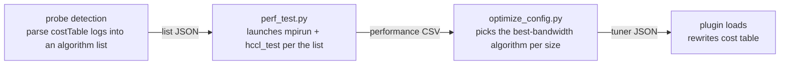

# HCCL Tuner Plugin Example

## Overview

This directory provides a reference implementation of the HCCL Tuner Plugin, demonstrating how to modify the cost table via an external `.so` plugin that reads a JSON configuration, thereby influencing the Selector's algorithm choice.

> **Incubating feature**: experimental capability, disabled by default (enable by setting `HCCL_TUNER_PLUGIN`); interface compatibility is not guaranteed until it becomes stable.

## Build

```bash
source /usr/local/Ascend/cann/set_env.sh
make
```

Artifact: `hccl_tuner_example.so`

The first build automatically downloads nlohmann/json (header-only) to `third_party/`. For offline environments, manually place `third_party/nlohmann/json.hpp` beforehand; `make` will skip the download if detected.

## Usage

```bash
export HCCL_TUNER_PLUGIN=/path/to/hccl_tuner_example.so
export HCCL_TUNER_CONFIG_FILE=/path/to/hccl_tuner_config.json
```

The plugin searches for the configuration file in the following order, loading the first readable one:

1. `$HCCL_TUNER_CONFIG_FILE` (skipped if not set)
2. `./hccl_tuner_config.json`
3. `/etc/hccl/hccl_tuner_config.json`

## Data Collection and Configuration Generation

Hand-writing JSON configuration makes it hard to guess the optimal algorithm for each topology. Two scripts in this directory turn it into a three-step workflow:



### Step 1: Probe the Algorithm List + Collect Performance Data (perf_test.py)

The script first probes automatically (embedded in the collection flow, no extra
steps): it runs hccl_test in per-engine rounds and reads the costTable from the logs to find the
algorithms the current environment actually supports, saving them as a list JSON.
It then collects only the algorithms in the list (further filtered by the CLI
options), writing the bandwidth and latency of each at each data size into a CSV.
The list comes from real test runs, so what gets measured is what actually works —
avoiding "configured A but silently ran B" mismatches in the timing data.

Prerequisites:

- Python >= 3.8
- `mpirun` in PATH (MPICH or Open MPI). For version requirements, see the
  [official install guide (Chinese)](https://gitcode.com/cann/oam-tools/blob/master/docs/zh/hccl_test/inst_and_compile.md):
  Open MPI 4.1.5 across all products (the only version supporting IPv6); MPICH
  4.1.3 for 950/A3 series, 3.2.1 for A2/Atlas series
- CANN environment sourced (`$ASCEND_HOME_PATH` set), with hccl_test at
  `$ASCEND_HOME_PATH/tools/hccl_test/bin/` (change via `--bin-dir`);
  the MPI runtime library linked by hccl_test (e.g. libmpi.so.12) must also be
  in `LD_LIBRARY_PATH`
- Device requirement: 950/960 series only (probing relies on costTable logs); 910B not supported
- Run the script outside an mpirun session; it exits with an error when a
  nested MPI session is detected
- Multi-node with MPICH: hostfile syntax in the `--hostfile` option; sourcing
  the CANN environment on the first node suffices, with libraries deployed at
  the same paths
- Multi-node with Open MPI: the hostfile must use Open MPI syntax (see the
  `--hostfile` option); `--prefix`, environment forwarding, and other options
  are auto-added by the script; sourcing on the first node still suffices, with
  libraries deployed at the same paths

Command example:

```bash
# Environment variables (per the official hccl_test execution guide (Chinese):
# https://gitcode.com/cann/oam-tools/blob/master/docs/zh/hccl_test/execution.md)
ulimit -n 65535
export INSTALL_DIR=/usr/local/Ascend/cann
source $INSTALL_DIR/set_env.sh
# MPICH
export PATH=/usr/local/mpich/bin:$PATH
export LD_LIBRARY_PATH=/usr/local/mpich/lib:${INSTALL_DIR}/lib64:$LD_LIBRARY_PATH
# or Open MPI
export PATH=/usr/local/openmpi/bin:$PATH
export LD_LIBRARY_PATH=/usr/local/openmpi/lib:${INSTALL_DIR}/lib64:$LD_LIBRARY_PATH

python3 perf_test.py --op-types allreduce,allgather --engines aicpu,ccusched --np-total 16 --npus 8 \
    --hostfile hostfile --minbytes 1K --maxbytes 2G --stepfactor 2 \
    --data-types fp32 --reduce-ops sum,prod --output hccl_perf.csv
```

#### Parameters

| Parameter | Required | Default | Description |
|-----------|----------|---------|-------------|
| `--op-types` | Yes | — | Operators to collect, comma-separated, `all` supported; see [Supported op_type](#supported-op_type) below for the value list |
| `--np-total` | Yes | — | Total rank count, i.e., the value of `mpirun -n` |
| `--npus` | No | auto-derived | NPUs per server, passed to hccl_test `-p`. Auto-derivation when omitted: `np-total / server line count` (non-comment lines in the hostfile), e.g., `--np-total 16` with a 2-line hostfile gives 8 per server; equals `np-total` on a single node; startup errors out when not divisible, specify explicitly |
| `--hostfile` | No | single-node mode if unset (servers=1) | Hostfile for multi-node, not needed on a single node. MPICH syntax: one entry per line, `IP:npus` (e.g., `10.10.130.22:8`) or bare `IP`; lines starting with `#` and blank lines are ignored; the two formats must not be mixed. Open MPI syntax: `IP slots=npus` per line (e.g., `10.10.130.22 slots=8`) |
| `--minbytes` / `--maxbytes` | No | no range limit if unset | Data size range, mapped to `-b` / `-e`; both must be given. Units: plain numbers are bytes; `K`/`M`/`G` suffixes are 1024-based (1K=1024B, 1M=1024K); decimals supported (e.g., `1.5K`) |
| `--stepbytes` | No | hccl_test default sequence if unset | Linear step (bytes), positive integer, mapped to `-i`; mutually exclusive with `--stepfactor`; if neither is given, hccl_test sweeps its default sequence |
| `--stepfactor` | No | hccl_test default sequence if unset | Geometric step factor, mapped to `-f`, float (typically 2, i.e., 1K→2K→4K…); mutually exclusive with `--stepbytes` |
| `--data-types` | No | `fp32` | Data types, comma-separated, supporting `int8`/`uint8`/`int16`/`uint16`/`int32`/`uint32`/`int64`/`uint64`/`fp16`/`fp32`/`fp64`/`bfp16`/`fp8e5m2`/`fp8e4m3`/`fp8e8m0`/`hif8`, mapped to `-d` |
| `--reduce-ops` | No | `sum` | Reduce operation types, comma-separated, supporting `sum`/`prod`/`max`/`min`, mapped to `-o`; probe expands along this dimension, non-reduce operators are unaffected |
| `--engines` | No | `all` | Collection engine, supports `aicpu` / `aiv` / `dpu` / `ccums` / `ccusched`; `all` expands to all of them (see notes below) |
| `--algos` | No | all | Explicit algorithm string (`HCCL_ALGO` semantics, e.g., `sole{mesh};parallel{mesh,nhr}`), intersected with the probe list |
| `--executors` / `--templates` | No | all | Expand combinations by executor × template, intersected with the probe list (ignored when `--algos` is present); see the executor/template sections below for values. Note this differs from the same-named JSON config fields: values are enum-validated here but not in the JSON config |
| `--warmup-iters` | No | 10 | Warmup iterations, mapped to `-w` |
| `--iters` | No | 20 | Iterations, mapped to `-n` |
| `--run-timeout` | No | 600 | Per-round timeout in seconds; the process tree is killed on timeout and the round is recorded as failed |
| `--pods` | No | 0 | Pod count; 0 means unspecified and the generated config does not constrain this dimension |
| `--super-pods` | No | 0 | Super pod count; same as above |
| `--output` | No | `hccl_perf.csv` | CSV output path |
| `--probe-output` | No | `<output>.algos.json` | Probe algorithm-list JSON path; reused automatically when the existing list matches the topology and parameters, delete the file to force a re-probe |
| `--bin-dir` | No | `tools/hccl_test/bin` | hccl_test directory, relative to `$ASCEND_HOME_PATH` or absolute |

For whitelist-style parameters (`--op-types` / `--data-types` / `--reduce-ops` / `--engines` / `--executors` / `--templates`), an out-of-whitelist value fails immediately at startup with the valid set listed.

#### Collection Behavior Notes

- **Engine mapping**: `--engines` engine names are mapped by the script to the
  hccl_test `-a` switches (e.g., `aicpu → -a aicpu_ts`; dpu receives no `-a`).
  Note the config says `aiv`, not `aiv_only`
- **Homogeneous setup required**: per-server NPU counts must be identical; a
  heterogeneous hostfile fails at startup
- **Probe round marks**: failed probe rounds carry `[failed]` /
  `[no costTable log]` / `[costTable empty]` / `[0 valid]` marks; if no
  costTable anchor is found across all rounds or the list is empty, the script
  errors out immediately (fail-fast)
- **List reuse**: if the JSON at `--probe-output` exists with a matching
  topology fingerprint and probe parameters, it is reused directly; delete the
  file to force a re-probe
- **Timeout tolerance**: each round times out after 600 seconds by default; the
  round's process tree is killed and collection continues. Failed rounds are
  recorded in the CSV as `check_result=failed` / `noresult` audit rows, with
  raw output appended to `<output>.raw` for troubleshooting
- **Incremental collection**: the CSV is append-only with a matching header;
  when a point is collected multiple times, config generation keeps the latest
  round per point by timestamp

### Step 2: Generate the Best Configuration (optimize_config.py)

```bash
python3 optimize_config.py --input hccl_perf.csv --output hccl_tuner_config.json
```

The script reads the CSV, groups by operator, data type, reduce type, buffsize, and
topology dimensions, picks the highest-bandwidth algorithm at each data-size point
(latency as tiebreaker), merges adjacent points with the same algorithm into
intervals, and assigns gaps between intervals to the right-hand interval. The
output is the plugin-format JSON.

A few conversions and bindings to be aware of:

- **Allgather-family per-rank conversion**: the size collected by hccl_test is the
  total each rank receives, while the plugin matches on what each rank sends at
  runtime. The value is divided by the rank count before rule generation; the raw
  CSV values are untouched
- **scatter total-send conversion**: the size collected by hccl_test is what each
  rank receives, while the plugin matches on the total the root sends at runtime.
  The value is multiplied by the rank count before rule generation; the raw CSV
  values are untouched
- **dpu rules enforce `min_servers>=2`**: see the "engine Available Values" section below
- **rules are bound to the collected buffsize**: when `HCCL_BUFFSIZE` is explicitly
  set during collection, rules carry a `buffer_size` exact match (the plugin
  matches on the total bytes of the two CCL buffers, send + receive, converted
  automatically by the script; the CSV still records the raw env value) and only
  take effect in a runtime environment with that buffsize (the plugin stays
  inactive otherwise); when unset, rules apply globally — keep the collection and
  runtime environments consistent. For multiple buffsizes, collect one round per
  value (explicitly set each round; point `--output` at the same CSV, which appends
  automatically), then generate one config covering all of them in a single run

Rows failing validation (e.g., executors not supported by the plugin, or
`check_result` being `failed` / `noresult` / `fallback`) are dropped with counts
and reasons logged, so one bad row never invalidates the whole config. `fallback`
means the row is outside the probe list's per-size set (the runtime silently fell
back to another algorithm); the data is invalid.

### Step 3: Load and Activate

```bash
export HCCL_TUNER_PLUGIN=/path/to/hccl_tuner_example.so
export HCCL_TUNER_CONFIG_FILE=/path/to/hccl_tuner_config.json
```

For multi-node deployment, the `.so` and JSON must be distributed to the same path on
every node with identical content; ranks on nodes where the plugin is not loaded select
algorithms independently with no cross-rank check, and inconsistent algorithm selection
can deadlock collective communication.
Then run your business workload as usual; the plugin rewrites the cost table
according to the config. See the next section for the config format.

### Other Files in This Directory

`tuner_common.py` holds the constant tables and pure functions shared by the two
scripts (CSV fields, registered-algorithm name splitting, probe list JSON I/O,
etc.). It is imported by both and is not meant to be run directly. The only
maintenance note: when HCCL's algorithm naming rules evolve (new
engine/executor/template tokens), sync the full vocabulary tables of
`split_algo_name` with the C++ `ParseAlgName` (`src/common/alg_parse.cc`);
otherwise new algorithms land in `unresolved` and never enter the collection plan.

## JSON Configuration Format

```json
{
  "version": 1,
  "op_types": {
    "allreduce": {
      "rules": [
        {
          "match": {
            "min_ranks": 8, "max_ranks": 8,
            "min_bytes": 0, "max_bytes": 65536,
            "data_type": "fp16"
          },
          "engine": "aicpu",
          "executor": "sole",
          "template": "nhr",
          "cost": 0.0
        }
      ]
    }
  }
}
```

### Top-level Fields

| Field | Type | Required | Description |
|-------|------|----------|-------------|
| `version` | int | Yes | Configuration format version, currently must be `1` |
| `op_types` | object | Yes | Rule set organized by operator type |

### Match Conditions (all AND; the first rule that actually modifies an entry wins)

If a rule hits but its target is absent from the cost table or disabled, it **falls through** to subsequent rules; if nothing applies, matched=0.

| Field | Type | Required | Description |
|-------|------|----------|-------------|
| `min_ranks` / `max_ranks` | uint32 | Yes | Communication domain rank count range |
| `min_bytes` / `max_bytes` | size_t | Yes | Data size range (bytes) |
| `data_type` | string | No | Data type (`int8`/`int16`/`int32`/`int64`/`uint8`/`uint16`/`uint32`/`uint64`/`fp16`/`float16`/`fp32`/`float32`/`fp64`/`float64`/`bfp16`/`bfloat16`) |
| `comm_name` | string | No | Communication domain name (substring match) |
| `min_npus_per_server` / `max_npus_per_server` | uint32 | No | NPUs per server range |
| `min_servers` / `max_servers` | uint32 | No | Server count range |
| `min_pods` / `max_pods` | uint32 | No | Pod count range |
| `min_super_pods` / `max_super_pods` | uint32 | No | Super pod count range |
| `buffer_size` | uint64 | No | Communication domain buffer size (exact match) |

### Match Behavior

- `engine` / `executor` / `template` (required) specify the target position in the cost table
- `template` for single-level algorithms is a single template name (e.g., `mesh`); for multi-level algorithms it is the lowercased concatenation of the remaining string after the executor in algName (e.g., `meshconcurnhrnhr`)
- `cost` (required) sets the cost value at that position; `0.0` means optimal
- The Selector chooses the minimum cost from the cost table to determine the algorithm

### engine Available Values

`aicpu` / `ccums` / `ccusched` / `aiv` / `dpu`

Note: `dpu` is **topology-exclusive and does not compete** with the other 4 device
engines. dpu algorithms register `isHostDpuOnly=true` and are selectable only on
hostdpu topologies (multi-server with a fully connected CLOS at the last level, see
`CheckHostDPUOnly`); in common environments all dpu algorithms are filtered out by
topology, and on hostdpu environments all device algorithms are filtered out.
Therefore optimize_config enforces `min_servers>=2` for dpu rules: dpu data
collected on a single node measures the silently-fallen-back algorithm, which is
invalid data.

### executor Available Values

executor is not enum-validated: the valid set evolves with HCCL versions (e.g., `strictordered` was added later), and a fixed enum would reject newly added values; typos are caught at runtime via the "no entry modified" warning. The following are common current values, subject to the dimension definitions of the HCCL version in use:

`sole` / `sequence` / `parallel` / `pipeline` / `concur` / `strictordered`

### template Available Values

template is not enum-validated: single-level is a single template name, multi-level is a lowercased concatenation of the remaining string after the executor; whether a rule takes effect is determined by matching the cost-table templateName (derived from algName via Enrich). Typos match no entry and are caught at runtime via warning.

Single-level:

`mesh` / `mesh2die` / `meshoneshot` / `meshtwoshot` / `meshconcur` / `meshmultilink` / `meshchunk` / `meshchunktwoshot` / `nhr` / `nhrmultilink` / `nhraicpureduce` / `meshsinglechannel` / `meshconcurrent`

Multi-level (concatenation string):

Take the lowercased remaining string after the executor in algName, e.g., `AicpuAllReduceSequenceMeshConcurNHRNHR` → `meshconcurnhrnhr`.

```json
{ "engine": "aicpu", "executor": "sequence", "template": "meshconcurnhrnhr", "cost": 0.0 }
```

### Supported op_type

`allreduce` / `allgather` / `broadcast` / `reduce` / `reduce_scatter` / `scatter` / `alltoall` / `alltoallv`

> The available values for engine / executor / template / op_type above are consistent with the dimension definitions of the HCCL algorithm selector.

### CSV Column Format

Each row of `hccl_perf.csv` is one collection point with fixed columns (for your
own post-processing reference):

| Column | Description |
|--------|-------------|
| `op_type` / `data_type` / `reduce_type` | Collection dimensions (`reduce_type` is `NA` for non-reduce operators) |
| `size_bytes` | Data size (bytes) |
| `engine` | Collection engine (`aicpu` / `aiv` / `dpu` / `ccums` / `ccusched`) |
| `algorithm.executor_type` / `algorithm.template_type` | Algorithm (multi-level templates are comma-separated, e.g., `meshconcur,nhr,nhr`) |
| `HCCL_BUFFSIZE` | Value of the `HCCL_BUFFSIZE` environment variable during collection |
| `ranks.ranks` / `ranks.npus_per_server` / `ranks.servers` / `ranks.pods` / `ranks.super_pods` | 5 topology fields (unspecified pods/super_pods are recorded as 0) |
| `check_result` | Result check status (values explained below) |
| `alg_bandwidth(GB/s)` / `alg_latency(us)` | Performance data (optimize_config picks by bandwidth) |
| `timestamp` | 17-digit compact timestamp `YYYYMMDDHHMMSSmmm` (dedup basis for incremental collection; invalid values are treated as oldest) |

`check_result` values:

| Value | Meaning | Used in optimization |
|-------|---------|----------------------|
| `success` | Algorithm result comparison passed | Yes |
| `NULL` | Result comparison not executed (hccl_test produced no comparison verdict, typical for operators without a reference implementation); treated as valid data | Yes |
| `failed` | Algorithm ran but the result comparison failed | No |
| `noresult` | No result data parsed | No |
| `fallback` | The (algorithm, size) pair is not in the probe list (`--probe-output`, default `<output>.algos.json`): HCCL silently fell back to the default algorithm at runtime, so the data is misattributed and treated as invalid | No |

`fallback` is the core value of the probe list: at probe time HCCL already decided "algorithm X is not applicable at size Y" (filtered from the costTable); if collection still explicitly requests X, HCCL does not error out but silently runs the default algorithm instead, and the output table still labels the row as X — the numbers actually belong to the default algorithm. A large number of `fallback` rows means the collection parameters exceeded the scope of the list (the `--probe-output` file): delete it to re-probe, or adjust `--algos`.

> Tiny sizes (byte-level, e.g. 4B) in the list may include selection rows from HCCL's internal control-plane operations during link setup (barrier/flag); the algorithm set at such sizes is slightly wider than real supportability, and `fallback` marking serves as the safety net during collection.

## Test

Python unit tests (covering all pure functions of `perf_test.py` / `optimize_config.py` / `tuner_common.py`):

```bash
python3 test_l0.py
```

C++ plugin test:

```bash
cd test
make
./test_plugin
```

## Plugin Interface

The plugin must export the symbol `hcclTunerPlugin_v1` (type `hcclTunerFuncs_v1_t`), containing two function pointers: `init` and `getCollInfo`. The HCCL core loads the plugin via `dlsym` to obtain this symbol.

See `src/ops/op_common/selector/inc/hccl_tuner_plugin.h` for details.

## Runtime Examples

The following are typical outputs from `./test_plugin`, demonstrating the plugin's behaviors.

### Rule Hit and Cost Override

AllReduce with 8 ranks, 4096B, fp32 matches a rule. The target algorithm's cost is changed from 100.0 to 0.0 (optimal preference). The Selector will pick this algorithm:

```
[TunerDFX] rule hit: opType=2 nBytes=4096 dataType=3 ruleIdx=0/2 engine=aicpu executor=sole template=meshoneshot cost=0.000000
[TunerDFX] modify: algName=AicpuAllReduceSoleMeshOneShot engine=aicpu executor=sole template=meshoneshot cost 100.000000 -> 0.000000
```

Multi-level algorithms are also supported. The `template` field is the lowercased remainder string after the executor in the algorithm name:

```
[TunerDFX] rule hit: opType=2 nBytes=4096 dataType=3 ruleIdx=0/1 engine=aicpu executor=sequence template=meshconcurnhrnhr cost=0.000000
[TunerDFX] modify: algName=AicpuAllReduceSequenceMeshConcurNHRNHR engine=aicpu executor=sequence template=meshconcurnhrnhr cost 5.000000 -> 0.000000
```

### No Match — No Intervention

4 ranks is outside the required 8–16 range. No rule matches, the cost table retains CostModel values:

```
[TunerDFX] no rule matched: opType=2 nBytes=4096 dataType=3
```

### Target Algorithm Disabled (cost<0) — Skip

The target entry has cost=-1 (already disabled). The plugin does not modify it (in `SelectMinCost`, cost<0 is treated as filtered and excluded from selection); the rule falls through and subsequent rules are still evaluated (fall-through details are DEBUG-level logs):

```
[TunerDFX] skip disabled: algName=AicpuAllReduceSoleMeshOneShot cost=-1.000000
```

### Schema Validation — Per-Rule Rejection; Format-Level Errors Reject the Whole Config

Rule-level errors (missing required fields, invalid enums, inverted ranges, invalid data_type, etc.) only reject that rule; the remaining rules still take effect. Only format-level errors (root is not an object, version missing or not 1, op_types missing) reject the whole config (safe degradation). Validation covers only part of the content (e.g., template spelling is not enum-validated):

```
Schema: unknown field 'mtach' in rule, skipping
Schema: rule missing required field 'match'
Schema: invalid engine 'invalid_engine'
Schema: min_ranks(16) > max_ranks(8)
tuner config loaded from hccl_tuner_config.json, opSetCount=1, totalRules=4, validRules=1, schemaErrors=3, schemaWarnings=1
Schema: 3 rules rejected, 1 rules active
```

Format-level error example (whole config rejected):

```
Schema: version must be 1, got 2
Schema fatal error (1), plugin will not intervene
```
